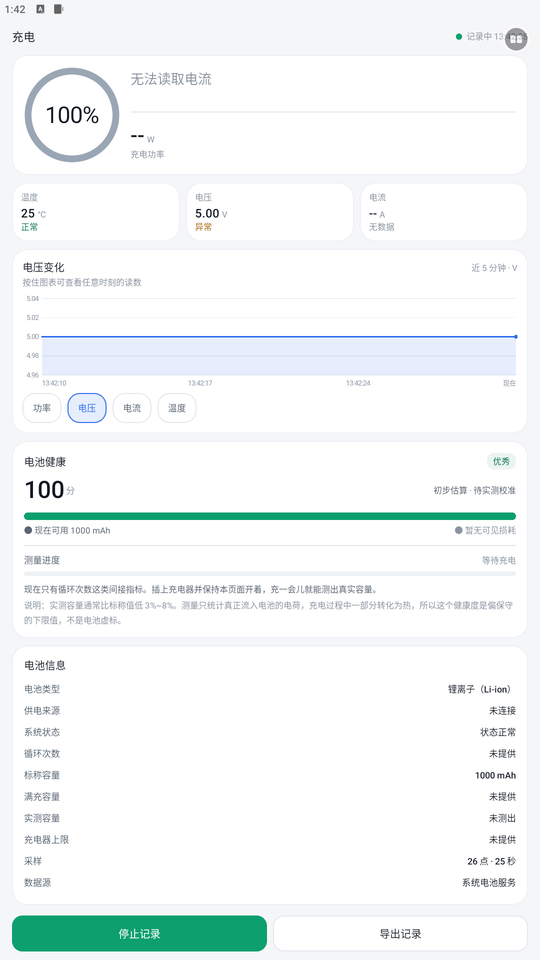
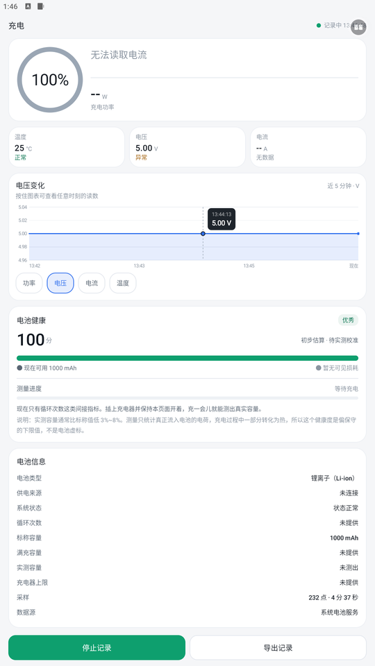

# Charge-X

### ✨ 实时读取充电电压、电流、温度，自动算功率，估算电池健康，并把采样记录导出成 CSV 的原生 Android 工具 📊


纯 Java + 原生 View，**零第三方依赖**，R8 全量压缩后 APK 约 44 KB。
支持 Android 7.0 (API 24) 及以上设备，围绕「读数要准、界面要看得懂、数据要能带走」打造。

🛠️ **Active development / 持续迭代中**

> **Warning**
>
> **电池数据高度依赖机型。** Android 没有统一的电池数据接口，本 App 走的是「官方 API + sysfs 双通道」：
> 多数机型能拿到 1 秒级的真实读数，部分机型会屏蔽 sysfs，只能退到系统缓存值（10~60 秒才变一次）。
> 界面右下角的「数据源」会如实告诉你当前用的是哪一条通道。

> **Warning**
>
> 本项目仅供学习与研究使用。电池健康度是基于公开数据推算的**估计值**，
> 不等于厂商售后检测结果，请勿作为维权、退换货或安全判断的唯一依据。
> 各厂商的 sysfs 节点语义存在私有约定，本项目不保证在所有机型上给出正确读数。

## 快速定位 / Start here

| 快速导航 | 说明 |
| --- | --- |
| [快速体验](#快速体验--getting-started) | 下载 APK 或从源码编译 |
| [界面](#界面--screenshots) | 真机截图：默认首屏与图表取值游标 |
| [核心特性](#核心特性--key-features) | 实时读数、图表游标、电池健康、CSV 导出 |
| [数据来源](#数据来源--data-sources) | 官方 API、sysfs、PowerProfile 各自能拿到什么 |
| [健康度算法](#健康度是怎么算的--health-algorithm) | 四级口径、库仑积分原理、为什么实测偏低 |
| [隐私与数据](#隐私与数据--privacy) | 不申请网络权限，数据全在本机 |
| [已知限制](#已知限制--known-limitations) | 厂商限制、算法边界、升级行为 |
| [构建](#构建--building) | 环境要求与编译命令 |

**核心亮点**

| 能力维度 | 亮点 |
| --- | --- |
| 实时读数 | 电压、电流、温度、功率 1 秒刷新；功率 = **电压 × 电流**，充电为正、放电为负 |
| 说人话 | 不甩数字甩结论：`正在快充，预计 18 分钟充满`；8.4 W 旁边标`快充`，33° 旁边标`正常` |
| 图表 | 单指标面积图 + 纵轴刻度值 + **按住拖动的取值游标**，像看股票一样逐点查值 |
| 电池健康 | 健康度 = **实际容量 ÷ 总容量**，四级来源降级，并把「口径」直接标在界面上 |
| 容量可视化 | 一条容量条同时表达标称容量、现在可用、老化损失，测量过程中兼作进度条 |
| 数据导出 | UTF-8 BOM 的 CSV 直接进 `Downloads`（API 29+ 免权限），Excel 打开不乱码 |
| 后台记录 | 前台服务 + WakeLock，切后台、锁屏照样采，通知栏常驻实时读数 |
| 体量 | 零依赖、无网络权限、21 个源文件、44 KB 安装包、内存常驻约 300 KB |

## 项目简介 / About

Charge-X 是用**纯 Java + 原生 View** 写的电池状态监视器，定位是「一个不打扰你的仪表」。
它不用 Compose、不引 AppCompat、不接图表库，唯一的依赖是自带的 JUnit 测试。

界面按信息优先级分三层，普通用户看第一层就够，工程师可以往下挖：

| 层级 | 内容 | 面向谁 |
| --- | --- | --- |
| **L1 · 一眼结论** | 电量环 + `正在快充 / 正在充电 / 正在放电 / 已充满` + 预计充满时间 + 实时功率大字 | 所有人 |
| **L2 · 辅助判断** | 温度 / 电压 / 电流三宫格（各带语义标签）、单指标曲线、电池健康卡 | 想多知道一点的人 |
| **L3 · 电池信息** | 电池类型、供电来源、系统状态、循环次数、标称容量、满充容量、实测容量、充电器上限、采样点数、数据源 | 排查问题的人 |

一条贯穿全项目的原则：**拿不到的数据就显示「未提供」，绝不编一个看起来精确的数字。**
健康度拿不到分母时，单位会从 `%` 变成「分」；实测值明显不可信时，会直接显示「待测」，
而不是给出一个会让人以为电池报废的百分比。

## 界面 / Screenshots

| 默认首屏 | 按住图表取值 |
| --- | --- |
|  |  |

> 💡 **截图说明**
>
> 截图取自 Android 9 模拟器。模拟器没有电流传感器，所以电流显示为「无数据」、功率为空，
> 电压曲线是一条恒定的 5 V —— 这些是运行环境造成的，真机上这一栏会有真实读数。
> 界面本身是从真机渲染结果直接截取的，不是设计稿。

## 核心特性 / Key Features

### 🔌 实时读数

- 双通道采集：sysfs 单节点直读（1 秒级）优先，读不到自动退回 `BatteryManager` 官方 API
- 单位启发式识别：电压 >100000 判 µV、2000~6000 判 mV；温度 >1500 判 m°C；电流用官方 µA 值比值自动校准 µA/mA
- 电流符号归一：不管各机型 `current_now` 的正负约定多混乱，统一成「充电为正、放电为负」
- 二次纠错：算出来的功率超过 300 W 必然单位错了，回退重算
- 语义化文案：功率 → `超级快充 / 正在快充 / 正在充电 / 未在充电`，电流为负 → `正在放电`

### 📈 图表与游标

- 单指标面积图（功率 / 电压 / 电流 / 温度四选一），**各用该指标的绝对量程**，
  不做独立归一化——四条线各自归一化叠在一起，0.1 V 的波动会和 3 A 的波动一样陡，那是系统性误导
- 纵轴带刻度值，步长吸附到 `1 / 2 / 2.5 / 5 / 10 × 10ⁿ`，读到的是 `4.0 4.2 4.4` 而不是 `4.352`
- 小数位由步长决定，不会出现 `4.0` 和 `4.00` 混排
- **按住出现垂直虚线 + 高亮点，横向滑动逐点跟随**，浮层显示该点的时刻与数值；松手消失
- 横向滑动才拦截手势，纵向滑动判定为「想滚动页面」，主动放行给 ScrollView
- 量程跨零时（放电功率为负）多画一条实心零基线，面积从零线填充而不是从底边填

### 🔋 电池健康

- 健康度 = **实际容量 ÷ 总容量**，副标题直接标明数字来源：`系统读数 / 系统容量 / 实测容量`
- 容量条：整条 = 标称容量，绿色段 = 现在还能用，浅红段 = 老化损失；未测出时默认「无损耗」画满
- 测量进度条：取「电量涨幅」与「电荷量」两个判据的**较小值**，不会出现进度满了但结果没出来
- 全自动：插上充电器就会在后台累计，充入够量自动出结果，**界面上没有任何「开始测量」按钮**
- 断点续测：锚点电量、累计电荷、时间戳每 20 秒落盘一次，杀进程、重启都不丢

### 📤 数据导出

- 一键把环形缓冲里的采样导出成 CSV
- API 29+ 走 MediaStore 写入 `Downloads/Charge-X`，**不需要任何存储权限**
- 低版本走 SAF `ACTION_CREATE_DOCUMENT`，由用户自己选目标位置
- UTF-8 带 BOM，Excel 双击打开中文表头不乱码；无数据的单元格留空，不写 `NaN`

### 🧩 电池信息

`BatteryManager` + sysfs 能解析出来的字段全部摊开：

电池类型（Li-ion → 锂离子）、供电来源（AC / USB / 无线 / 底座，按 `EXTRA_PLUGGED` 位掩码解析）、
系统健康状态、循环次数、标称容量、满充容量、实测容量、充电器声明的 `voltage_max` / `current_max`、
采样点数与记录时长、当前数据源（点一下才露出真实内核路径）。

> 💡 **数据源这一行是排查问题的钥匙**
>
> 显示「系统电池接口」= 拿到了 sysfs，读数 1 秒级。
> 显示「系统电池服务」= 该机型屏蔽了 sysfs，只能读系统缓存，曲线会呈阶梯状。
> 这是厂商限制，不是 App 的 bug。

### 🛡️ 后台记录

- `dataSync` 类型前台服务 + 1 秒节拍器，锁屏、切后台都不中断
- 通知栏常驻摘要，不用打开 App 就能看到当前功率
- WakeLock 加超时保护，避免异常退出后锁死
- 环形缓冲用 `long[] / float[]` 基本类型数组，14400 点（约 4 小时）常驻约 300 KB，
  每秒复用同一个对象，不产生垃圾

## 数据来源 / Data Sources

| 通道 | 能拿到什么 | 刷新率 | 备注 |
| --- | --- | --- | --- |
| sysfs 单节点 | `current_now` / `voltage_now` / `temp` / `capacity` | 1 秒 | `/sys/class/power_supply/battery`，部分机型被 SELinux 拦 |
| sysfs uevent | `STATUS` / `TECHNOLOGY` / `CYCLE_COUNT` / `CHARGE_FULL` / `CHARGE_FULL_DESIGN` / `SOH`… | 静态，读一次 | 键名在不同机型上比单节点稳定 |
| 充电器节点 | `usb` / `ac` / `wireless` 的 `voltage_max`、`current_max` | 静态，读一次 | 声明能力，不是实时输出 |
| `BatteryManager` | `CURRENT_NOW`、`ACTION_BATTERY_CHANGED` 的 voltage / temp / status / plugged / health / level / technology / cycle_count | 系统 HAL 缓存，10~60 秒 | 唯一官方来源，兼容性最好 |
| `PowerProfile`（反射） | 电池标称容量 mAh | 开机后固定 | `@hide` 系统资源，`charge_full_design` 缺失时的最后兜底 |

**拿不到的**：充电器真实输出功率、快充协议（PD / QC / SCP）协商结果、电池设计循环寿命。
这些需要 root 或外接硬件，公开 API 没有。

## 健康度是怎么算的 / Health Algorithm

Android 没有「健康度 89%」这种公开 API，`EXTRA_HEALTH` 只给良好 / 过热 / 损坏。
所以按可信度分四级降级，并且**把口径写在界面上**，不让用户面对一个来路不明的数字：

| 优先级 | 口径 | 来源 | 界面标注 |
| --- | --- | --- | --- |
| ① | SOH 直读 | sysfs `soh` / `state_of_health` / `battery_soh` 等 8 个候选节点 + uevent | `系统读数` |
| ② | 系统容量 | `charge_full ÷ charge_full_design` | `系统容量` |
| ③ | 实测容量 | 库仑积分，需充够 20 个百分点 | `实测容量` |
| ④ | 兜底评分 | `100 − 循环惩罚 − 状态惩罚 − 高温惩罚` | 单位显示「分」 |

**关键取舍**：`charge_full` 与 `charge_full_design` 相差在 ±2% 以内时，说明该节点报的
就是标称值，代表不了衰减。此时如果实测值也不可信，**直接不给百分比**，退回「待测」——
一个看起来精确的错误数字，比承认不知道更糟。

### 实测原理

库仑积分：从 45% 充到 65%，这一路累计流入多少 mAh，满容量就是 `充入量 ÷ 20%`。

偏差来源有四个，代码里逐一堵住了：

1. **窗口太窄** —— 电量计是整数百分比，±1% 的量化误差在 10% 窗口里会被放大 10 倍。现在要求 20 个百分点。
2. **SOC 两端非线性** —— 低电量段受电压回弹影响会虚高，高电量末段是恒压涓流。现在只在 25%~90% 之间锚定。
3. **电量计校准跳变** —— 系统偶尔把 60 直接报成 64，那 4 个点不是充出来的。单帧跳变超过 3% 就整段作废。
4. **单次离群值污染** —— 一次异常估计会永久拉低算术平均。现在保留最近 8 次，
   用截尾均值（去掉最大最小），并拒绝偏离中位数 30% 以上的值。

断档处理也改过一次：早期版本用 `dt = min(dt, 10s)` 截断，等于把断档期间充进去的电凭空抹掉，
方向永远是往低估。现在改成「断档超 60 秒直接重新锚定」，不再截断。

### 实测值为什么比标称值低 3%~8%

只统计真正流入电池的电荷，充电过程中一部分转化为热；电量计本身还有 ±1% 的取整误差。
所以它是**偏保守的下限值**，界面上有一行常驻说明。

## 隐私与数据 / Privacy

- **不申请 `INTERNET` 权限**，App 在物理上没有联网能力，这一点可以在系统权限页自行核对
- 不接入广告、统计、崩溃分析 SDK，APK 里除了自带的 JUnit 测试依赖，没有任何第三方库
- 所有数据都留在本机：实时读数在内存环形缓冲，健康度结果在 `SharedPreferences`
- CSV 只在用户主动点「导出」时写一次，写进 `Downloads/Charge-X`
- 卸载即清空，没有云端、没有账号、没有遥测

## 已知限制 / Known Limitations

1. **系统设置里显示的电池健康度，多数机型读不到** —— 那是厂商私有算法，只有少数机型放进了 sysfs。
   读不到时 App 只能自己算，结果可能和系统值有差距，此时请以健康卡上的「口径」标注为准。
2. **实测值偏保守** —— 见上文，低 3%~8% 属正常范围。
3. **官方 API 的电流刷新慢** —— 若机型 sysfs 不可读，曲线会呈阶梯状，这是系统缓存导致的。
4. **采样缓冲上限 14400 点**（约 4 小时），超出后覆盖最旧数据。
5. **无法获取充电器真实输出功率与快充协议** —— `voltage_max` / `current_max` 是充电器声明的能力。
6. **部分机型的 sysfs 数值恒为 0 或恒定不变**，属厂商限制，非 App 问题。
7. **算法升级会清空历史实测值** —— `HealthTracker.SCHEMA` 每次变动都会丢掉旧的测量结果，
   因为不同口径的数字不能混在一起平均。升级后需要重新充一次电。
8. **未在全部机型上实测** —— 开发与验证环境只覆盖到「编译 + 71 个单元测试 + 出包」，
   真机读数依赖各家 sysfs 实现，遇到异常欢迎提 Issue 并附上电池信息卡截图。

## 快速体验 / Getting Started

1. 到 [Releases](../../releases) 下载 `Charge-X-1.0.0.apk`
2. 传到手机点击安装（首次需允许「安装未知来源应用」）
3. 打开 App，授予通知权限（用于常驻采样通知）
4. 插上充电器，界面自动开始记录

发布包使用 debug key 签名，仅便于直接安装，**不适合上架分发**。

## 构建 / Building

要求：JDK 17、Android SDK `compileSdk 35`、Gradle 8.x。工程不含 wrapper 二进制，
用本机 Gradle 或自行补 `gradle wrapper` 均可。

```bash
# 复制 local.properties 并写入自己的 SDK 路径
echo "sdk.dir=/path/to/Android/Sdk" > local.properties

# 跑单元测试
gradle testDebugUnitTest

# 出安装包
gradle assembleRelease
# 产物：app/build/outputs/apk/release/app-release.apk
```

`compileSdk 35 / targetSdk 34 / minSdk 24`，R8 与资源压缩全开，release 与 debug 都走压缩。

> **Warning**
>
> 自定义 View（`PowerRingView` / `ChartView` / `MeterView`）由 XML 反射实例化，
> `proguard-rules.pro` 里必须 keep 类名，否则 release 包会启动即崩，而 debug 包不一定暴露这个问题。

### CI / GitHub Actions

`.github/workflows/android.yml` 会在推送到 `main` 或提 PR 时自动跑 71 个单元测试并构建 release APK，
产物作为 artifact 挂在 Actions 页面。

打 tag 时额外自动发布：

```bash
git tag v1.0.0
git push origin v1.0.0
```

Release 页面会附上 `Charge-X-v1.0.0.apk` 和自动生成的变更说明。

## CSV 格式 / CSV Export

UTF-8 BOM，逗号分隔，时间按本地时区：

```csv
时间,时间戳ms,已记录秒,电压V,电流A,温度C,功率W,充电状态
2026-11-26 03:46:12,1764099972000,0,3.869,3.118,27.5,12.06,charging
2026-11-26 03:46:13,1764099973000,1,3.871,3.115,27.5,12.06,charging
```

功率列带符号（充电为正、放电为负），与界面一致；无数据的单元格留空而不是写 `NaN`，
避免 Excel 把那几列当成文本。

## 目录结构 / Project Layout

```
app/src/main/java/com/xiaoeyv/chargex/
├── MainActivity.java        界面渲染与交互（三层信息架构）
├── ChargeService.java       前台服务，1 秒采样、通知、WakeLock
├── Sampler.java             采集调度：双通道选择、单位校准、符号归一
├── BatterySource.java       官方 BatteryManager 通道
├── SysfsSource.java         sysfs 节点与 uevent 解析
├── PowerProfileSource.java  PowerProfile 反射取标称容量
├── PowerMath.java           换算与符号归一的纯函数
├── Reading.java             一次采样的数据载体
├── SampleRing.java          基本类型环形缓冲
├── SampleStore.java         服务与界面共享的进程内状态
├── AxisScale.java           纵轴刻度算法（步长吸附）
├── ChartView.java           单指标面积图 + 取值游标
├── PowerRingView.java       电量环
├── MeterView.java           容量分段条 / 进度条
├── DeviceInfo.java          设备信息字段与文案映射
├── EtaEstimator.java        预计充满时间
├── HealthEstimator.java     健康度评估（四级口径）
├── HealthSession.java       库仑积分会话
├── HealthTracker.java       健康度持久化与汇总
├── CsvFormat.java           CSV 序列化
└── CsvExporter.java         写入 Downloads / SAF
```

`app/src/test/java/com/xiaoeyv/chargex/` 下 7 个测试类、71 个单元测试，
覆盖换算、符号归一、单位校准、sysfs 字符串解析、环形缓冲溢出、刻度算法、
积分会话、健康度评估、CSV 格式与文案映射。纯逻辑全部下沉成不依赖 Android 的静态方法，
所以这些测试跑在 JVM 上，不需要设备或模拟器。

## 参与、支持与许可 / Contributing, Support & License

- **参与贡献**：欢迎 Issue 与 PR。报告读数异常时请附上机型、系统版本，以及电池信息卡的截图
  （标称容量 / 满充容量 / 实测容量三行最关键，能直接区分是节点语义问题还是积分问题）。
- **支持项目**：点个 Star 就够，不接受捐赠。
- **许可证**：本项目使用 **MIT** 发布，可自由使用、修改和分发，保留版权声明即可，详细条款见 [LICENSE](LICENSE)。
- **第三方代码**：无。运行时不依赖任何第三方库，测试期仅用 JUnit 4。
